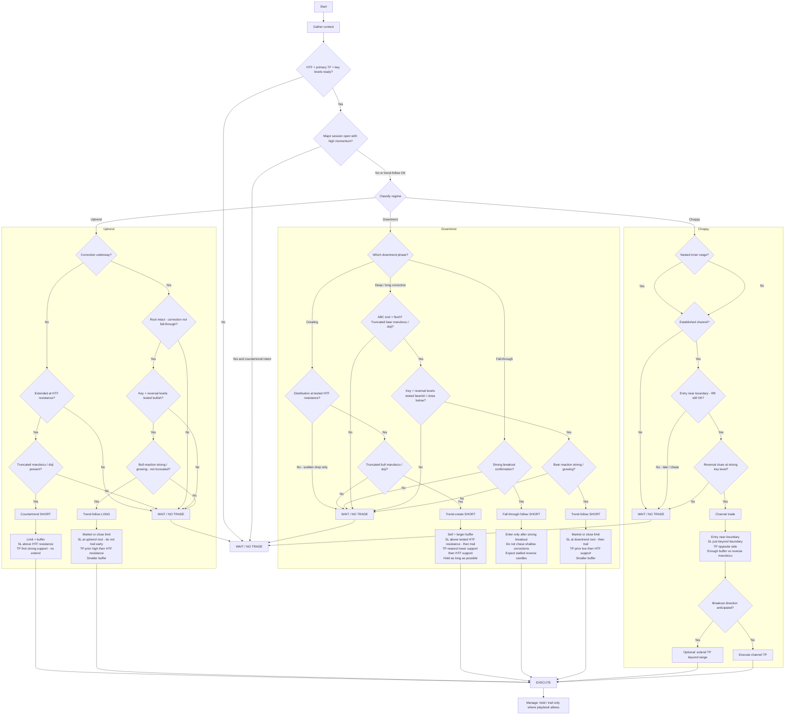

# Trading Decision Flow

Complete decision sequence from context → regime → setup → execute or wait.

Related:

- [Trading the Uptrend](trade_up_trend.md)
- [Trading the Downtrend](trade_down_trend.md)
- [Trading the Choppy Market](trade_choppy_range.md)

## Path summary

| Regime | Allowed setups | Hard waits |
|--------|----------------|------------|
| Uptrend | Trend-follow long after tested correction; countertrend short only on extension + truncation at HTF resistance | No correction; untested levels; weak bull reaction; root fall-through; countertrend before truncation / at major open |
| Downtrend | Create at distribution; follow deep correction; fall-through only after strong breakout | Sudden drop without distribution; chase short correction; untested correction levels; fall-through without breakout |
| Choppy | Boundary-to-boundary; nested ranges; optional extended TP if breakout clear | Chase / late entry; no channel; weak reversal clues |

## Notes from Nov 7

- Prior uptrend key levels must be tested to separate correction vs real downtrend.
- Stronger downtrend root → higher confidence resistance gets pierced.
- Multi-consolidation + strong growing marubozu trends reverse slowly.
- Fall-through from heavy root: shallow corrections, long SL risk, truncated reverse traps → only follow after strong breakout.
- Bigger moves need bigger timeframe validation.
